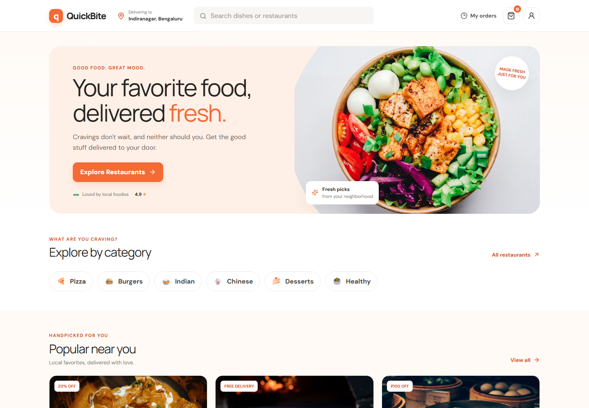
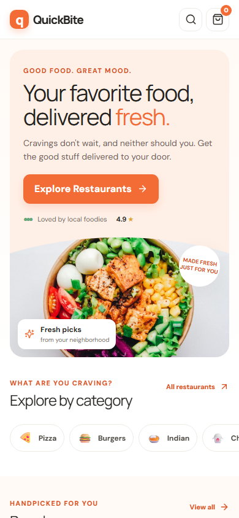
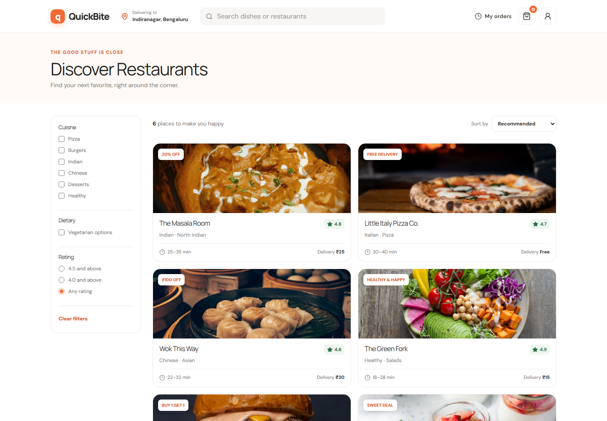
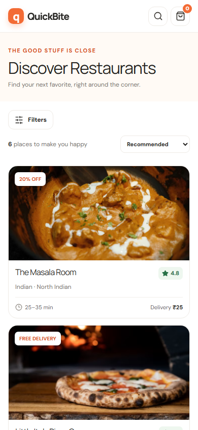

# QuickBite

A responsive food-discovery and ordering frontend built as a portfolio-ready demo. QuickBite uses local sample data and browser storage; it does not connect to a restaurant, payment provider, or delivery service.

## Features

- Home discovery with cuisine categories, featured restaurants, popular dishes, and a first-order offer.
- Restaurant search across restaurant names, cuisines, and menu dishes.
- Cuisine, vegetarian, rating, and sorting controls with an empty-results state.
- Restaurant menus with item descriptions, prices, dietary labels, and add-to-cart controls.
- Cart quantity changes/removal, Indian rupee price totals, and localStorage persistence.
- Redeemable `FIRSTBITE` offer (₹150 maximum discount) included in cart, checkout, and order totals.
- Validated demo delivery form, illustrative payment choices, generated order reference, order confirmation, and saved order history/details.
- Responsive desktop, tablet, and mobile layouts, accessible labels, and keyboard-visible focus.

## Architecture

```text
src/
  components/    Shared layout, cards, and empty state
  data/          Typed local restaurants, menus, and categories
  hooks/         Cart context and persistence
  lib/           Reusable cart calculations and currency formatting
  pages/         Routed home, discovery, menu, cart, checkout, and order pages
  App.tsx        React Router route table
  styles.css     Tailwind entry point and responsive design system
tests/           Cart calculation and ordering interaction tests
```

Cart calculations are centralized in `src/lib/cart.ts`. The cart is persisted as `quickbite-cart` in localStorage. Demo orders are saved under `quickbite-orders`; the latest checkout confirmation is also held in sessionStorage for its success screen.

## Technologies

- React 18 and TypeScript
- Vite
- Tailwind CSS (configured and included in the stylesheet pipeline), with a small custom CSS design system
- React Router
- Lucide React
- Vitest, Testing Library, and jsdom

## Installation and development

Requirements: Node.js 22.12+ and npm.

```bash
npm install
npm run dev
```

Open the local URL printed by Vite (normally `http://localhost:5173`).

## Production build

```bash
npm run build
npm run preview
```

The production bundle is generated in `dist/`.

## Tests

```bash
npm test
```

The suite checks cart arithmetic and quantity changes, and covers adding an item, updating cart totals, and checkout validation.

## Screenshots

Project screenshots are stored in [`screenshots/`](./screenshots/) at 1440px desktop and 390px mobile widths.

| Desktop ┬╖ Home | Mobile ┬╖ Home |
| --- | --- |
|  |  |

| Desktop ┬╖ Restaurants | Mobile ┬╖ Restaurants |
| --- | --- |
|  |  |

## Demo limitations

- The restaurant and menu catalog is local sample data.
- Orders are saved only in this browser's local storage.
- Checkout and payment controls are illustrative. No payment, restaurant submission, delivery dispatch, account login, or real ETA is provided.
- Food photography and the DM Sans/Manrope fonts are loaded from Unsplash and Google Fonts, so those assets need an internet connection.

## Future improvements

- Add a real API and authenticated user accounts.
- Add restaurant availability, delivery addresses, and live order status.
- Add currency/tax rules and configurable promotion logic.
- Add dedicated visual regression screenshots and broader accessibility testing.

## Beginner-friendly implementation plan

1. Install Node.js, open this folder in VS Code, and run `npm install` in the integrated terminal.
2. Start `npm run dev` and open the Vite URL to browse the app.
3. Explore `src/data/mockData.ts` to update restaurants and menu items.
4. Explore `src/pages/` to update screen content and `src/components/` for reusable UI.
5. Change cart rules in `src/lib/cart.ts`; the UI reads those shared calculations through `src/hooks/useCart.tsx`.
6. Run `npm test` after changing cart behavior and `npm run build` before sharing a production version.

## Exact VS Code steps

1. Select **File → Open Folder…** and choose the QuickBite project directory.
2. Open **Terminal → New Terminal**.
3. Run `npm install`.
4. Run `npm run dev`; Ctrl+click the local Vite URL (or copy it into your browser).
5. Use the Explorer panel to open `src/pages/HomePage.tsx`, `src/data/mockData.ts`, or `src/styles.css`.
6. Run `npm test` and `npm run build` in the terminal to validate your edits.
